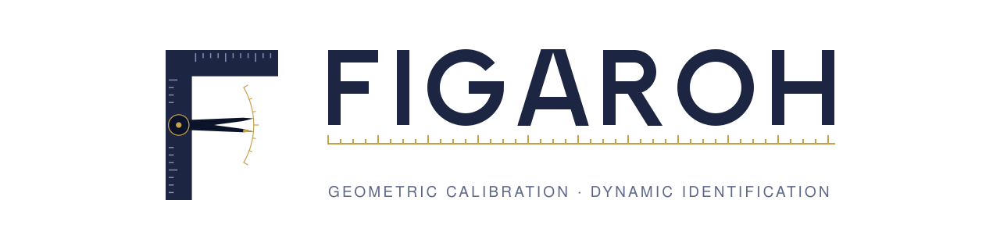

<p align="center">
  
</p>

**F**ree dynamics **I**dentification and **G**eometrical c**A**libration of **RO**bot and **H**uman

<p align="center">
  <a href="https://www.apache.org/licenses/LICENSE-2.0"></a>
  <a href="https://pypi.org/project/figaroh/"></a>
  <a href="https://thanhndv212.github.io/figaroh-plus/"></a>
  <a href="https://deepwiki.com/thanhndv212/figaroh-plus"></a>
</p>

FIGAROH is a Python toolbox for geometric calibration and dynamic parameter
identification of rigid multi-body systems described by a URDF. It handles
serial manipulators and tree-structured systems such as humanoids and mobile
manipulators, and covers the whole loop: design the experiment, fit the
parameters, validate them on held-out data, and export an updated model.

## Install

```bash
pip install figaroh
```

Optimal trajectory generation also needs `cyipopt`, which is not
pip-installable. Use the conda environment for that, or for development:

```bash
git clone https://github.com/thanhndv212/figaroh-plus.git
cd figaroh-plus
conda env create -f environment.yml
conda activate figaroh-dev
pip install -e .
```

## Quickstart

FIGAROH's workflow classes are subclassed once per robot. The
[figaroh-examples](https://github.com/thanhndv212/figaroh-examples) repository
ships those subclasses, configs and data for each supported robot. The fastest
way to see a complete run is its UR10 identification reference, which takes a
few seconds:

```bash
git clone https://github.com/thanhndv212/figaroh-examples.git
cd figaroh-examples/examples/ur10
python identification_reference.py
```

It fits the UR10 dynamic parameters on a simulated training log, checks the
prediction error on a separate held-out log, computes a physically consistent
estimate, exports an identified URDF, and archives the run with its config,
revisions and an HTML report under `results/runs/`.

To use your own robot, follow the
[Getting Started guide](https://thanhndv212.github.io/figaroh-plus/getting_started/)
and the [Configuration System](https://thanhndv212.github.io/figaroh-plus/concepts/configuration/)
page; the examples repository has a
[new-example guide](https://github.com/thanhndv212/figaroh-examples/blob/main/docs/new-example-guide.md)
and a scaffold script.

## What it does

**Geometric calibration** (`figaroh.calibration`) estimates joint offsets and
frame transforms from end-effector measurements: motion capture, cameras,
laser trackers, or contact with a plane when there is no external metrology.
Identifiable parameters are found by QR decomposition, and the fit is a
Levenberg–Marquardt solve with outlier removal.

**Dynamic identification** (`figaroh.identification`) fits masses, inertias,
friction and actuator inertia from joint positions and measured effort. A run
goes through up to three stages:

- `fit`: base parameters by least squares, with optional weighted least squares
  and decimation. Base-parameter selection is deterministic across platforms.
- `reconstruction`: a full standard-parameter set recovered from the base fit.
- `physical_fit`: a direct LMI fit constrained to physically consistent
  inertias.

`identification.select_stage` chooses which stage is reported, validated and
exported; a requested stage that fails is rejected rather than replaced.
`problem.torque_fit_joints` restricts the fit to the joints whose effort you
trust.

**Optimal experiment design** (`figaroh.optimal`) selects well-conditioned
calibration postures and generates exciting identification trajectories
(cubic splines optimised with IPOPT under joint, velocity, torque and collision
limits).

**Reporting and verification.** Every run can write a self-contained HTML
report (`solve(html_report=True)`) and a machine-readable verdict
(`verify()`). The verdict states its scope: an `execution` PASS means the
numerics are sound, while a `prediction` PASS needs separate validation data
and per-joint limits that you declare. `generate_compare_page()` diffs two
archived runs offline. See
[Reporting & Verification](https://thanhndv212.github.io/figaroh-plus/reporting_and_verification/).

**Backends.** Pinocchio is the default dynamics backend; MuJoCo is available
as an optional backend (`pip install mujoco`). See
[Backends](https://thanhndv212.github.io/figaroh-plus/concepts/backends/).

## Outputs

Both tasks write the result back into a copy of your URDF
(`figaroh.tools.urdf_exporter.export_urdf`), but they change different
parts of it:

| | Written to the URDF | Not written to the URDF |
|---|---|---|
| Calibration | Joint placements: corrected joint offsets and frame transforms | Metrology frames (`base_*`, `pEE*`, `phiEE*`): the pose of the measurement system and the marker or tool. These are returned separately; `frame_settings_doc()` explains them |
| Identification | Link mass, centre of mass and inertia, joint friction (`BaseIdentification.export_urdf`) | The base-parameter fit, which has no per-link values: export needs `select_stage: reconstruction` or `physical_fit` |

The exporter refuses inertias that are not physically consistent unless you
pass `allow_infeasible=True`. Identification exports only an accepted
estimate and reloads the written URDF with Pinocchio as a check.

Every run can also write:

- the estimated parameters as YAML, CSV or NPZ (`save_results()`);
- a self-contained HTML report (`export_html_report()`);
- a JSON verdict with the scope, per-stage status and each check
  (`export_verification_report()`).

## What's new in 1.0

- A declared public API with a stability policy: the
  [Public API and stability](https://thanhndv212.github.io/figaroh-plus/api/stability/)
  page lists what is supported, what is experimental and what is internal.
  Deprecated names now warn for at least one minor release and are removed
  only in a major release.
- Features deprecated before 1.0 are removed, including the legacy flat config
  format. Convert old files once with
  `python -m figaroh.utils.config_migration --input old.yaml --output new.yaml`.
- Calibration refuses to export a fit whose solver failed, as identification
  already did. Pass `allow_failed_fit=True` to export one for diagnosis.
- Python 3.10 to 3.14 are supported; 3.8 and 3.9 users stay on 0.7.x.

The full list, including fixes and behaviour changes, is in the
[CHANGELOG](https://github.com/thanhndv212/figaroh-plus/blob/main/CHANGELOG.md).

## Supported platforms

| | Tested |
|---|---|
| Python | 3.10, 3.12 and 3.14 (3.11 and 3.13 are supported but not tested) |
| Pinocchio | 3.7 (with ndcurves 2.0.0.1) and 4.1 (with ndcurves 2.3.0) |
| OS | Linux (CI), macOS (maintainer). Windows is not tested. |

Install Pinocchio and ndcurves together so their native libraries match. Other
versions within `pin>=3.7,<5` may work but have no CI profile; see the
[version support decision](https://github.com/thanhndv212/figaroh-plus/blob/main/docs/decisions/pinocchio-version-support.md).

## Documentation

| | |
|---|---|
| [Documentation site](https://thanhndv212.github.io/figaroh-plus/) | Guides, tutorials, configuration reference, API reference |
| [Tutorials](https://thanhndv212.github.io/figaroh-plus/tutorials/) | Calibration, identification and optimal design walkthroughs |
| [ARCHITECTURE.md](https://github.com/thanhndv212/figaroh-plus/blob/main/ARCHITECTURE.md) | Package layout and design |
| [CHANGELOG.md](https://github.com/thanhndv212/figaroh-plus/blob/main/CHANGELOG.md) | Changes by release |
| [ROADMAP.md](https://github.com/thanhndv212/figaroh-plus/blob/main/ROADMAP.md) | Planned work |
| [CONTRIBUTING.md](https://github.com/thanhndv212/figaroh-plus/blob/main/CONTRIBUTING.md) | Branches, review, validation and release process |

**Working with an AI coding agent?** [`skills/`](https://github.com/thanhndv212/figaroh-plus/blob/main/skills/) holds agent skills
that set up a calibration, identification, optimal-design or new-robot task
end to end. Start with [`figaroh-start`](https://github.com/thanhndv212/figaroh-plus/blob/main/skills/figaroh-start/SKILL.md), which
routes to the right one, and [`figaroh-setup-env`](https://github.com/thanhndv212/figaroh-plus/blob/main/skills/figaroh-setup-env/SKILL.md),
whose `doctor.sh` checks your environment first.

## Citation

If you use FIGAROH in your research, please cite:

```bibtex
@inproceedings{nguyen2023figaroh,
  title={FIGAROH: a Python toolbox for dynamic identification and geometric calibration of robots and humans},
  author={Nguyen, Dinh Vinh Thanh and Bonnet, Vincent and Maxime, Sabbah and Gautier, Maxime and Fernbach, Pierre and others},
  booktitle={IEEE-RAS International Conference on Humanoid Robots},
  pages={1--8},
  year={2023},
  address={Austin, TX, United States},
  doi={10.1109/Humanoids57100.2023.10375232},
  url={https://hal.science/hal-04234676v2}
}
```

<details>
<summary>Related work</summary>

```bibtex
@inproceedings{nguyen2024improving,
  title={Improving Operational Accuracy of a Mobile Manipulator by Modeling Geometric and Non-Geometric Parameters},
  author={Nguyen, Thanh D. V. and Bonnet, V. and Fernbach, P. and Flayols, T. and Lamiraux, F.},
  booktitle={2024 IEEE-RAS 23rd International Conference on Humanoid Robots (Humanoids)},
  pages={965--972},
  year={2024},
  address={Nancy, France},
  doi={10.1109/Humanoids58906.2024.10769790}
}

@techreport{nguyen2025humanoid,
  title={Humanoid Robot Whole-body Geometric Calibration with Embedded Sensors and a Single Plane},
  author={Nguyen, Thanh D V and Bonnet, Vincent and Fernbach, Pierre and Daney, David and Lamiraux, Florent},
  year={2025},
  institution={HAL},
  url={https://hal.science/hal-05169055}
}
```

</details>

## License

Apache License 2.0; see [LICENSE](https://github.com/thanhndv212/figaroh-plus/blob/main/LICENSE).

FIGAROH started at LAAS-CNRS ([original GitLab repository](https://gitlab.laas.fr/gepetto/figaroh));
this repository is its maintained continuation.
